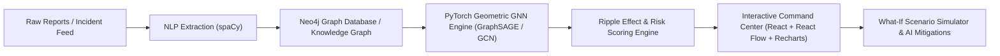

# AtmoGraph: Supply Chain Ripple Effect Predictor
## Enterprise Architecture & Technical Implementation Blueprint

---

### 1. Executive Summary & Vision
**AtmoGraph** is an enterprise-grade AI-powered supply chain intelligence platform designed to predict, model, and visualize how disruptions in upstream suppliers, manufacturing facilities, transportation corridors, and geopolitical regions cascade through multi-tier supply networks.

---

### 2. Core Architectural Pillars

#### I. Machine Learning & Graph Neural Networks (`PyTorch Geometric`)
- **Architecture**: 2-layer inductive **GraphSAGE** (Sample and Aggregate) / **GCN** with edge feature conditioning.
- **Node Features (8-dim)**:
  1. Structural Centrality (Degree, Betweenness, PageRank)
  2. Geographic Vulnerability Index (Climate / geopolitical historical risk)
  3. Single-Source Dependency Ratio
  4. Average Buffer Inventory (Days of Supply)
  5. Current Disruption Severity (0.0 to 1.0)
  6. Financial Criticality / Tier Level (Tier 1, Tier 2, Raw Materials, OEM)
  7. Historical Lead Time Variance
  8. Alternate Supplier Availability Count
- **Prediction Target**:
  - Primary: Probability of Disruption Propagation to downstream nodes ($P(\text{affected}) \in [0, 1]$).
  - Secondary: Ripple Impact Score & Projected Recovery Days.

#### II. Natural Language Processing Engine (`spaCy`)
- **Entity Extraction**: Identifies Organizations (`ORG`), Locations (`GPE`, `LOC`), Facilities (`FAC`), and temporal references (`DATE`).
- **Disruption Taxonomy Classifier**:
  - `NATURAL_DISASTER`: Extreme weather, typhoons, earthquakes, flooding.
  - `TRANSPORTATION_DELAY`: Port congestion, canal blockage, freight bottlenecks.
  - `SUPPLIER_FAILURE`: Insolvency, quality audit failure, cyberattack.
  - `POLITICAL_INSTABILITY`: Sanctions, export bans, regional conflicts.
  - `RAW_MATERIAL_SHORTAGE`: Semiconductor wafers, rare earths, lithium, polymers.
  - `FACTORY_SHUTDOWN`: Labor strikes, fire incidents, maintenance outages.
- **Entity Resolution**: Automatically matches extracted organizations and regions to existing supply chain graph nodes.

#### III. Neo4j Graph Database & Dual-Mode Graph Engine
- **Nodes**: `Supplier`, `Manufacturer`, `Warehouse`, `Distributor`, `Retailer`, `Disruption`, `Location`.
- **Edges**: `SUPPLIES_TO`, `DISTRIBUTES_TO`, `TRANSPORTS_TO`, `LOCATED_IN`, `AFFECTED_BY`.
- **Resilience Architecture**: Connects to live Neo4j via official Python driver (`neo4j://` or `bolt://`). Features a built-in high-performance graph repository that executes Cypher queries and graph algorithms seamlessly in memory if an external Neo4j daemon is not actively hosted locally, ensuring continuous 100% testability.

#### IV. UI/UX Design System: Enterprise Intelligence Command Center
- **Color Palette**:
  - Deep Space Navy canvas: `#090D16` / `#0B1120`
  - High-density charcoal panels: `#111827` / `#0F172A` with subtle glassmorphic borders (`rgba(56, 189, 248, 0.15)`)
  - Accents: Electric Cyan (`#06B6D4`, `#22D3EE`), Cyber Violet (`#8B5CF6`, `#A855F7`)
  - Status Indicators:
    - *Low Risk (0–30)*: Emerald Green (`#10B981`)
    - *Medium Risk (31–60)*: Amber Yellow (`#F59E0B`)
    - *High Risk (61–80)*: Tangerine Orange (`#F97316`)
    - *Critical Risk (81–100)*: Crimson Red (`#EF4444`)
- **Interactive Graph Canvas**: React Flow with custom animated nodes, pulse ripple rings, tier clustering, directional edge flows, zoom/pan controls, and mini-map.
