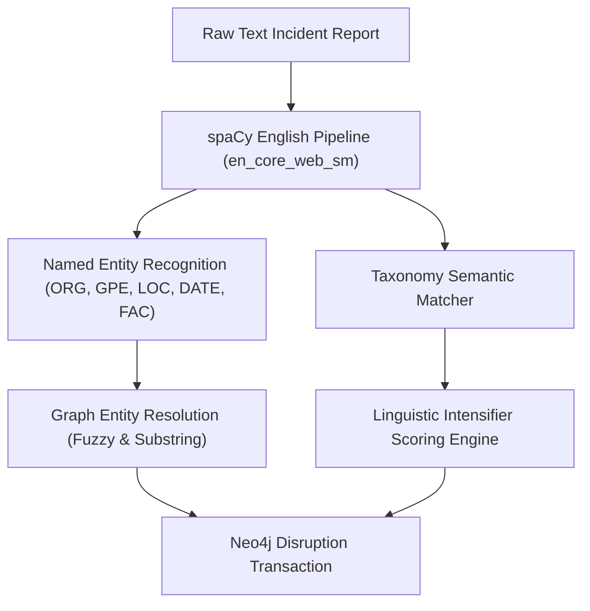

# AtmoGraph: Supply Chain Intelligence Methodology
## Mathematical Formulations, NLP Taxonomy & Graph Neural Network Architecture

---

### 1. Supply Chain Topological Representation
A multi-tier supply chain is formulated as a directed attributed knowledge graph:
$$\mathcal{G} = (\mathcal{V}, \mathcal{E}, \mathbf{X}, \mathbf{E})$$
where:
- $\mathcal{V} = \{v_1, v_2, \dots, v_N\}$ represents supply chain entities (Raw Material Suppliers, Component Foundries, Module Assemblers, OEMs, Warehouses, Distributors, Retailers).
- $\mathcal{E} \subseteq \mathcal{V} \times \mathcal{V}$ denotes directed component flows, logistics lanes, and contractual obligations.
- $\mathbf{X} \in \mathbb{R}^{N \times 8}$ is the node feature matrix capturing operational, structural, and vulnerability dimensions.
- $\mathbf{E} \in \mathbb{R}^{|\mathcal{E}| \times 4}$ encapsulates edge characteristics (component criticality, lead time in days, volume units, and single-source flag).

---

### 2. Node Feature Vector Specification ($\mathbf{x}_i \in \mathbb{R}^8$)

| Dimension | Feature Name | Description | Mathematical Formulation / Scale |
| :--- | :--- | :--- | :--- |
| $x_{i, 0}$ | Normalized In-Degree | Number of upstream supplier dependencies | $\text{deg}^-(v_i) / \max(\text{deg}^-)$ |
| $x_{i, 1}$ | Normalized Out-Degree | Number of downstream consumers / fan-out | $\text{deg}^+(v_i) / \max(\text{deg}^+)$ |
| $x_{i, 2}$ | Financial Criticality | Strategic priority / tier importance | Continuous $\in [0.4, 1.0]$ |
| $x_{i, 3}$ | Single-Source Flag | Binary sole-source indicator | $\mathbb{I}(\text{sole\_source})$ |
| $x_{i, 4}$ | Buffer Stock Ratio | Days of inventory buffer over 60-day base | $b_i / 60.0$ |
| $x_{i, 5}$ | Lead Time Variance | Historical volatility in component transit | $\sigma_{\text{lead}} / 30.0$ |
| $x_{i, 6}$ | Shock Intensity | Current disruption severity applied at node | $s_i \in [0.0, 1.0]$ |
| $x_{i, 7}$ | Geographic Vulnerability | Regional climate & geopolitical hazard index | $g_i \in [0.1, 0.9]$ |

---

### 3. Graph Neural Network (GNN) Message-Passing Architecture

AtmoGraph implements a 2-layer inductive **GraphSAGE** (Sample and Aggregate) model with Layer Normalization and multi-task prediction heads.

#### Layer 1 Message Aggregation:
$$\mathbf{h}_{\mathcal{N}(i)}^{(1)} = \text{MEAN} \left( \left\{ \mathbf{x}_j \mid j \in \mathcal{N}_{\text{in}}(i) \right\} \right)$$
$$\mathbf{h}_i^{(1)} = \text{LeakyReLU} \left( \text{LayerNorm} \left( \mathbf{W}_1 \cdot \left[ \mathbf{x}_i \parallel \mathbf{h}_{\mathcal{N}(i)}^{(1)} \right] \right) \right)$$

#### Layer 2 Message Aggregation:
$$\mathbf{h}_{\mathcal{N}(i)}^{(2)} = \text{MEAN} \left( \left\{ \mathbf{h}_j^{(1)} \mid j \in \mathcal{N}_{\text{in}}(i) \right\} \right)$$
$$\mathbf{h}_i^{(2)} = \text{LeakyReLU} \left( \text{LayerNorm} \left( \mathbf{W}_2 \cdot \left[ \mathbf{h}_i^{(1)} \parallel \mathbf{h}_{\mathcal{N}(i)}^{(2)} \right] \right) \right)$$

#### Multi-Task Prediction Heads:
1. **Propagation Probability Head (Classification)**:
   $$\hat{y}_i = \sigma \left( \mathbf{W}_{\text{cls}}^{(2)} \cdot \text{ReLU} \left( \mathbf{W}_{\text{cls}}^{(1)} \mathbf{h}_i^{(2)} \right) \right)$$
   where $\hat{y}_i \in [0, 1]$ predicts whether node $v_i$ will suffer operational disruption.

2. **Downstream Risk Delta Head (Regression)**:
   $$\Delta \hat{R}_i = 50.0 \times \sigma \left( \mathbf{W}_{\text{reg}}^{(2)} \cdot \text{ReLU} \left( \mathbf{W}_{\text{reg}}^{(1)} \mathbf{h}_i^{(2)} \right) \right)$$
   predicting the numerical risk elevation score $\Delta R_i \in [0, 50]$ points.

#### Multi-Task Loss Function:
$$\mathcal{L} = \mathcal{L}_{\text{BCE}}(\hat{y}, y) + \lambda \mathcal{L}_{\text{MSE}}(\Delta \hat{R}, \Delta R), \quad \lambda = 0.02$$

---

### 4. Natural Language Processing (spaCy) Extraction Engine

The NLP module parses unstructured incident bulletins, maritime notices, and news articles to automatically populate the graph knowledge base:

#### Taxonomy Categories:
1. `Natural Disasters`: Extreme weather, floods, earthquakes, typhoons.
2. `Transportation Delays`: Port congestion, canal blockage, freight strikes.
3. `Supplier Failures`: Machinery breakdown, quality defects, insolvency.
4. `Political Instability`: Sanctions, export bans, labor strikes, regulatory embargoes.
5. `Raw Material Shortages`: Polysilicon, lithium carbonate, neon gas, rare earth minerals.
6. `Factory Shutdowns`: Cleanroom contamination, fires, power blackouts.

---

### 5. Multi-Factor Transparent Risk Scoring Formulation

To avoid black-box ambiguity, the overall risk score $R(v_i) \in [0, 100]$ is computed as:
$$R(v_i) = S_{\text{centrality}}(v_i) + S_{\text{upstream}}(v_i) + S_{\text{single\_src}}(v_i) + S_{\text{buffer}}(v_i) + S_{\text{geo}}(v_i)$$

Where:
1. **Structural Centrality** ($0 \le S_{\text{centrality}} \le 25$):
   $$S_{\text{centrality}}(v_i) = \min \left( 25, 60 \cdot C_B(v_i) + 100 \cdot PR(v_i) + 2.5 \cdot \text{deg}^+(v_i) \right)$$
2. **Upstream Exposure** ($0 \le S_{\text{upstream}} \le 25$):
   $$S_{\text{upstream}}(v_i) = \min \left( 25, 3.5 \cdot |\text{Ancestors}(v_i)| + 2.0 \cdot \text{deg}^-(v_i) \right)$$
3. **Single Source Penalty** ($S_{\text{single\_src}} \in \{4, 18\}$):
   $$S_{\text{single\_src}}(v_i) = \begin{cases} 18.0 & \text{if sole source supplier} \\ 4.0 & \text{otherwise} \end{cases}$$
4. **Buffer Deficiency** ($0 \le S_{\text{buffer}} \le 15$):
   $$S_{\text{buffer}}(v_i) = 15.0 \times \left( 1.0 - \min\left(1.0, \frac{\text{Buffer Days}}{\text{Lead Time Days}}\right) \right)$$
5. **Geographic Hazard** ($4 \le S_{\text{geo}} \le 14$):
   Vulnerability index based on country climate risk and geopolitical tension.

#### Classification Brackets:
- **Low Risk**: $0 \le R < 31$
- **Medium Risk**: $31 \le R < 61$
- **High Risk**: $61 \le R < 81$
- **Critical Risk**: $81 \le R \le 100$
